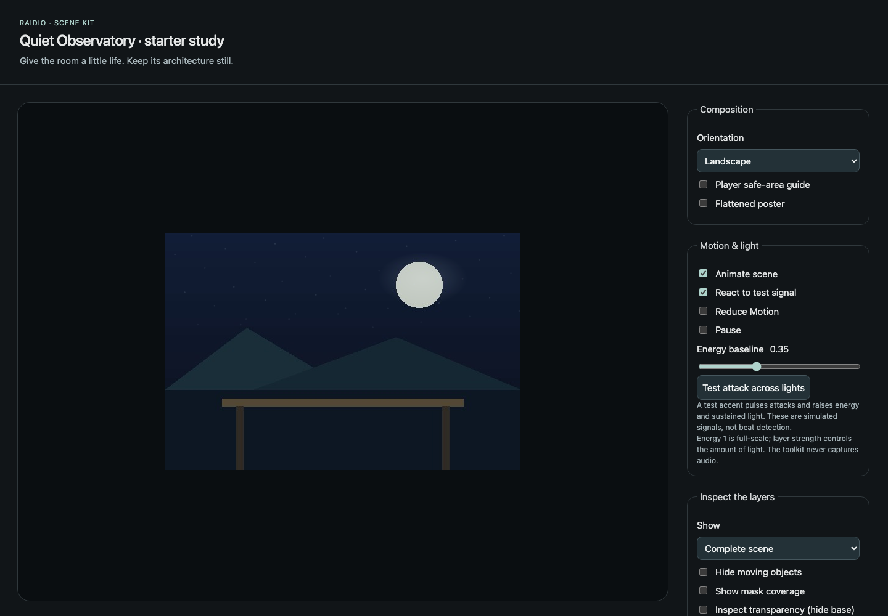

# Raidio Scene Kit

Local tools for building layered listening scenes: a stationary illustration,
independent moving details, atmosphere, and light that can respond to music.
Validate and preview a scene, then package it for import into a supporting Raidio build.



The actual local preview of the original geometric starter. It demonstrates the
format and controls; it is not one of Raidio's curated illustrations.

- Author coordinated landscape and portrait scenes with separate layers and masks.
- Inspect motion, transparency, light response, and reduced-motion posters locally.
- Validate resources, strip incidental image metadata, and produce a reproducible
  `.raidioscene` package while retaining intentional attribution.

Scene Kit does not generate images. Use your chosen image tools to make the art;
the toolkit needs no provider key, Raidio account, or cloud service.

## Try the starter

Requires Python 3.12+ and uv. The public release is pinned to `v0.1.1`.

```sh
uv tool install git+https://github.com/keyanfayaz/raidio-scene-kit.git@v0.1.1
raidio-scene init dream-room
raidio-scene preview dream-room
raidio-scene pack dream-room --output dream-room.raidioscene
raidio-scene validate dream-room.raidioscene --json
```

The preview binds to `127.0.0.1` and reads no remote resources. Import the package
in the signed-in Raidio app's Artwork section on a build that supports scene
packages. The toolkit does not log in, upload, or publish scenes.

## Author and contribute

Start with the [authoring guide](skills/create-raidio-scene/SKILL.md),
[format contract](FORMAT.md), and [full guide](GUIDE.md), which includes the
copyable agent prompt, Python API, packaging limits, and development checks.
Visual quality and native-device performance still require review beyond validation.

[MIT](LICENSE) covers the toolkit, schema, documentation, and original starter.
User artwork retains its own licensing terms; the license does not cover the
rest of Raidio or third-party art. Preserve scene provenance when adapting work.
